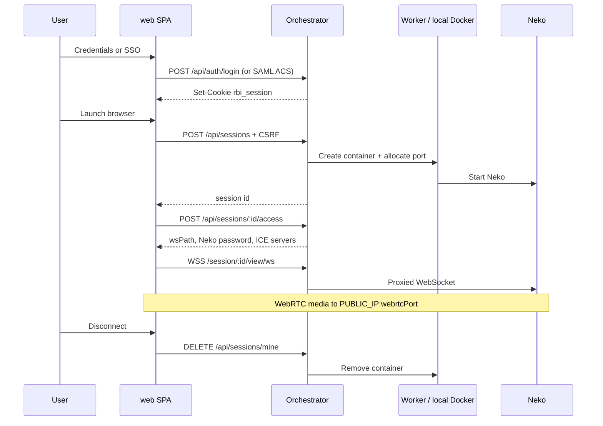

# Architecture

Browser Isolation is a **control plane** (portal + orchestrator) that starts **data-plane** Neko containers and streams their desktops to users over WebRTC.

```text
┌─────────────┐     HTTPS / WSS      ┌──────────────────┐
│ User browser│─────────────────────▶│  Orchestrator    │
│  (web SPA)  │                      │  + static UI     │
└──────┬──────┘                      │  SQLite, auth    │
       │                             └────────┬─────────┘
       │ WebRTC media                         │ Docker API
       │ (UDP/TCP mux ports)                  │ or worker /v1
       ▼                                      ▼
┌─────────────┐                      ┌──────────────────┐
│ PUBLIC_IP   │◀── ICE candidates ───│ Neko container    │
│ :52000+     │                      │ (Chrome/Firefox…)│
└─────────────┘                      └──────────────────┘
```

Signaling and the portal stay on the orchestrator. **Media** goes peer-to-peer (or via TURN) to the host that runs the container.

---

## Roles (same image, different entry)

One container image (`ghcr.io/thecookies/browserisolation`) serves both roles. The entrypoint chooses based on `RBI_ROLE` (or CLI args):

| Role | How it starts | What it does |
| --- | --- | --- |
| **Orchestrator** | `RBI_ROLE=orchestrator` (default) → `dist/index.js` | Portal UI, auth, SQLite, session ACL proxy, scheduler, enroll API |
| **Worker** | `RBI_ROLE=worker` → `dist/worker-main.js` | Agent on `/v1/*`; creates Neko locally; ICE uses this host’s `PUBLIC_IP` |

**Single-node:** orchestrator with `LOCAL_WORKER_ENABLED=true` (worker id `local`) — no separate worker container needed.

**Multi-host:** portal on one machine; browser hosts run the same image as workers and self-enroll. See [WORKERS.md](WORKERS.md).

---

## Packages

### Orchestrator (`orchestrator/`)

Node **26+** + **Fastify** service that:

- Authenticates users (local bcrypt and optional SAML)
- Stores portal sessions, browser sessions, settings, workers, audit in **SQLite** (`better-sqlite3`)
- Creates/destroys Neko containers via **dockerode** (local) or remote **worker agents**
- Reverse-proxies `/session/:id/view/*` (HTTP + WebSocket) to Neko after ACL checks
- Runs a background **reaper** and, on boot, **reconciles** DB rows with labeled containers
- Optionally runs as a **worker agent** (`worker-main.ts`) exposing `/v1/*`
- Serves optional **branding** (logo) from disk next to the database

Entry: `src/index.ts` (portal) · `src/worker-main.ts` (agent).

### Web (`web/`)

React 19 + Vite SPA:

- Login / dashboard / session viewer / admin console
- Typed API client (`api.ts`) with CSRF headers
- Custom Neko WebRTC client under `viewer/`
- Dark mode preference, change-password (local users), admin branding upload

In production the orchestrator serves `web/dist`. In development Vite proxies API and view traffic to `:8080`.

### Neko containers

Official images `ghcr.io/m1k1o/neko/<browser>:<tag>`. Each session gets:

- A container on network `rbi-browsers` (default), or host networking when `BROWSER_NETWORK_MODE=host`
- One host **WebRTC mux port** (UDP + TCP) from `WEBRTC_PORT_RANGE`
- Injected managed policies from `orchestrator/neko-policies/`
- Optional named volume for a persistent browser profile

---

## Deploy picture (how pieces connect)

```text
Developer laptop                    GitHub                         Alma hosts
─────────────────                   ──────                         ──────────
npm run dev  ──┐                    push main                      install-orchestrator.sh
Compose build ─┼──► Dockerfile ──► Actions ──► ghcr.io/…:latest ──► browser-isolation
               │                    (publish-image.yml)              (host net + sock)
               │                                                   install-worker.sh
               └──────────────────────────────────────────────────► browser-isolation-worker
                                                                      enroll → Authorize
                                                                      → Neko images pulled
```

- **Dev:** Compose or `npm run dev` (bridge networking is fine).
- **Production (Alma):** blank-box install scripts under `deploy/podman/` — host network, Podman socket at `/run/podman/podman.sock`, config in `/etc/browser-isolation/.env`.
- **Quadlet** units under `deploy/podman/*.container` still exist for reference but are **not** the recommended path; installers stop old Quadlet services when present.

Details: [SETUP_GHCR_ALMA.md](SETUP_GHCR_ALMA.md) · [PODMAN.md](PODMAN.md) · [deploy/podman/README.md](../deploy/podman/README.md).

---

## Request path: login → stream → disconnect



Important invariants:

1. **One browser session per portal user** (`browser_sessions.owner_username` UNIQUE). Launch reconnects if the container is still up.
2. **ACL**: owner or admin (`access.ts`). Proxy uses the portal cookie, not CSRF.
3. **Viewer credentials** are Neko admin password + display name `rbi`, not the portal password.
4. **Logout** destroys the user’s browser container.

---

## Module map (orchestrator)

| Area | Files | Responsibility |
| --- | --- | --- |
| Bootstrap | `index.ts`, `config.ts`, `env-file.ts`, `db.ts` | Load `.env` (+ `/config/.env`), open SQLite, wire services |
| HTTP app | `app.ts`, `routes/*`, `proxy.ts` | Cookies, CSRF, routes, static SPA, Neko proxy |
| Auth | `auth/*` | Local users, SAML, `subjectId` / profile keys |
| Branding | `branding-store.ts`, `routes/branding.ts` | Logo on disk next to DB; public + admin routes |
| Browser sessions | `browser-sessions.ts`, `browser-session-store.ts` | Launch, access, destroy |
| Docker | `docker/*` | Runtime, labels, policies, profile paths, security |
| Lifecycle | `lifecycle.ts`, `viewer-tracker.ts` | Reconcile, idle/max-age reaper |
| Workers | `workers/*`, `worker-agent/app.ts` | Placement, poller, remote client, agent API, enroll grants |
| Admin data | `settings-store.ts`, `audit-store.ts`, `user-preferences.ts` | Overrides, audit, persist + dark mode |

---

## Module map (web)

| Area | Files | Responsibility |
| --- | --- | --- |
| Shell | `App.tsx`, `main.tsx`, `Shell.tsx` | Routes and session bootstrap |
| Pages | `pages/*` | Login, dashboard, session, admin tabs |
| API | `api.ts` | Fetch + CSRF + types |
| Viewer | `viewer/*` | WebRTC, signaling, keyboard, geometry |
| Files | `SessionFiles.tsx` | Optional Neko file transfer UI |

Admin routes under `/admin/*` require `me.role === "admin"` in the SPA; the API enforces the same.

---

## Data model (SQLite)

File: `DATABASE_PATH` (Compose / Alma: `/data/rbi.sqlite` on volume `rbi-data`).

| Table | Purpose |
| --- | --- |
| `portal_sessions` | Logged-in cookie sessions + CSRF token |
| `local_users` | Bcrypt accounts (seeded once from `AUTH_USERS`) |
| `user_preferences` | Persist-profile + dark-mode flags per `subject_id` |
| `app_settings` | Admin overrides of env-backed config |
| `browser_sessions` | Active isolated browsers (container ids, ports, Neko secrets) |
| `workers` | Local + remote worker registry |
| `worker_grants` | Authorization memory across delete/re-enroll |
| `profile_placements` | Sticky worker for persistent profiles |
| `audit_events` | Admin/user action log |

Logo files live under `{dirname(DATABASE_PATH)}/branding/` (not in SQLite). Schema and migrations: `orchestrator/src/db.ts`.

---

## Docker / Podman conventions

| Kind | Convention |
| --- | --- |
| Network | `BROWSER_NETWORK` (default `rbi-browsers`); mode `bridge` (Compose) or `host` (Alma installers) |
| Socket | `DOCKER_SOCKET` — Compose default `/run/podman/podman.sock` (override for Docker Engine); Alma installers use `/run/podman/podman.sock` |
| Container name | `rbi-{first 12 chars of session id}` |
| Labels | `rbi.managed=true`, `rbi.owner`, `rbi.session`, `rbi.browser`, `rbi.webrtc_port` |
| Profile volume | `rbi-profile-{32-hex}-{browserId}` (e.g. `…-google-chrome`) + matching labels |
| Neko HTTP | Port `8080` on the browser network (proxied, not published to clients) |
| WebRTC | Host-published mux port per session |

On orchestrator start, containers with `rbi.managed=true` are reconciled against `browser_sessions`.

---

## Auth and security model

| Mechanism | Behavior |
| --- | --- |
| Portal cookie | `rbi_session`, httpOnly, SameSite=Lax, optional Secure |
| CSRF | Header `X-CSRF-Token` on mutating `/api/*` (SAML ACS + worker enroll exempt) |
| Roles | `user` \| `admin` — admin is the **role**, not the username string |
| Browser ACL | Owner or admin |
| Clipboard / downloads | Gated by `ALLOW_CLIPBOARD` / `ALLOW_DOWNLOADS` |
| Headers | CSP, `X-Frame-Options`, `nosniff`, `no-store` on API |

Identity ownership for profiles uses `subjectId` (`local:…` or `saml:…`). See [USER_IDENTITY.md](USER_IDENTITY.md).

---

## Workers and placement

- Default: orchestrator is also worker id `local` (`LOCAL_WORKER_ENABLED=true`).
- Remote agents: Bearer-authenticated `/v1/*` on `WORKER_PORT` (default 8090). Enroll uses `WORKER_ENROLL_TOKEN` (same value becomes the agent Bearer for that deployment).
- Scheduler picks the online enabled worker with the lowest `activeSessions` (sticky id tie-break).
- Persistent profiles prefer the worker recorded in `profile_placements`.
- `worker_grants` remembers Authorize/Deauthorize across row delete + re-enroll.

Details: [WORKERS.md](WORKERS.md).

---

## Session lifecycle

| Phase | Behavior |
| --- | --- |
| Create | Place → allocate WebRTC port → create container → insert row |
| Activity | Proxy / access updates `last_activity_at`; connected viewers counted in memory |
| Idle reaper | No viewers + idle ≥ `IDLE_TIMEOUT_MINUTES` → destroy |
| Max age | Age ≥ `MAX_SESSION_HOURS` → destroy |
| Reconcile | Boot: adopt matches, drop stale rows, remove orphan managed containers |
| Destroy | Remove container via placement; delete SQLite row |

Implementation: `lifecycle.ts`, `browser-sessions.ts`.

---

## Configuration layering

```text
process env
    + repo-root /.env          (local / Compose)
    + /config/.env             (Alma mount; wins when present)
         ↓
   loadConfig()  →  Config object
         ↑
   app_settings (SQLite) hydrated on top
   via settings-store (Admin → Settings)
```

On first container start with an empty `/config/.env`, `deploy/podman/entrypoint.sh` creates one (random admin password unless the installer already wrote the file). Existing `.env` is never overwritten.

Editable fields are declared in `settings-fields.ts`. Infrastructure keys stay read-only in the UI, including: bind address, `DATABASE_PATH`, `DOCKER_SOCKET`, `BROWSER_NETWORK`, `BROWSER_NETWORK_MODE`, `WEBRTC_PORT_RANGE`.

Full catalog: [../.env.example](../.env.example).

---

## Related docs

- [DEVELOPMENT.md](DEVELOPMENT.md) — where to change code day to day  
- [API.md](API.md) — route inventory  
- [DEPLOYMENT.md](DEPLOYMENT.md) — how this maps to hosts and networks  
- [SETUP_GHCR_ALMA.md](SETUP_GHCR_ALMA.md) — blank-box Alma install  
- [PLAN.md](PLAN.md) — product phases  
